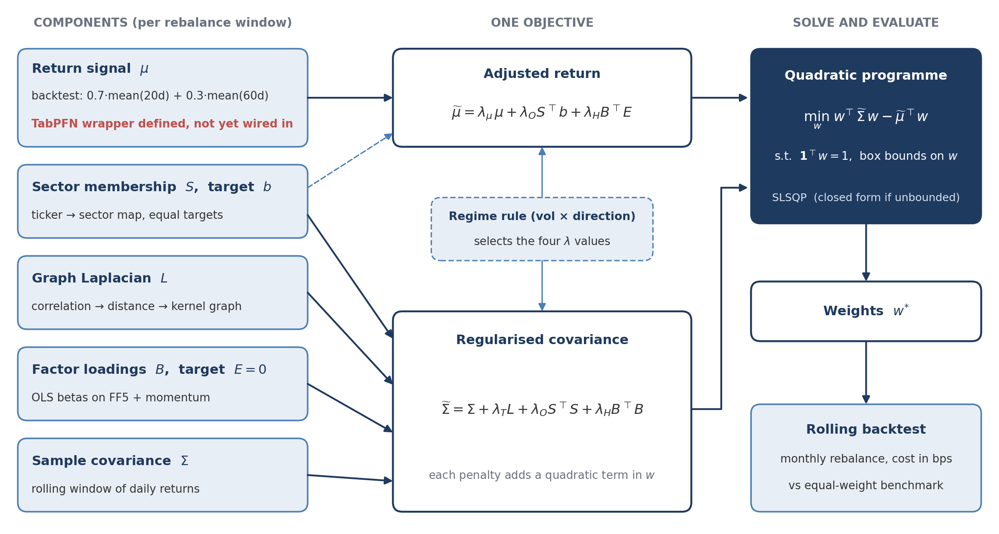
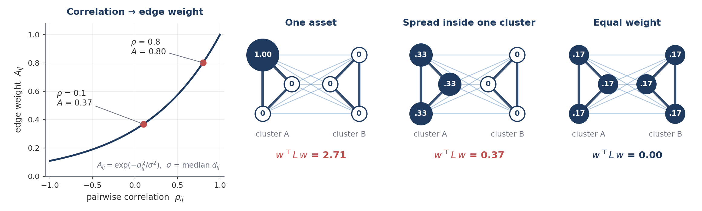

# Unified Lagrangian Portfolio Optimizer

> A penalised mean–variance optimizer that folds a correlation-graph Laplacian, sector targets and factor-neutrality penalties into one quadratic objective, with a rolling backtest engine. A TabPFN return-prediction wrapper is included but not yet wired into the backtest.

김재하 (Jaeha Kim) · [github.com/summerjinhere](https://github.com/summerjinhere)



*구조도(개념도). 리밸런싱 시점마다 왼쪽의 입력을 계산해 하나의 2차 목적함수로 합치고, 그 해를 롤링 백테스트에 넘긴다.*

## 개요

포트폴리오 최적화에서 보통 따로 다루는 네 가지 요구를 하나의 2차 목적함수에 벌점 항으로 넣어 한 번에 푸는 연구용 코드다. 현재 상태를 먼저 밝힌다.

| 요구 | 목적함수에 들어가는 형태 | 현재 구현 |
|---|---|---|
| 기대수익 신호 | 선형항 $\lambda_\mu \mu$ | 20일·60일 평균 수익률의 가중합. TabPFN 래퍼는 정의만 되어 있고 백테스트에서 호출되지 않는다 |
| 상관 구조 (topology) | $\lambda_T L$ | 상관계수로 만든 완전연결 그래프의 라플라시안 |
| 섹터 배분 (ontology) | $\lambda_O S^\top S$ , $\lambda_O S^\top b$ | 코드에 적어 둔 티커→섹터 표, 섹터 균등 목표 |
| 팩터 중립 (hedge) | $\lambda_H B^\top B$ | Fama-French 5팩터 + 모멘텀에 대한 OLS 베타, 목표 노출 0 |

커밋된 백테스트 결과가 없으므로 이 README에는 성과 수치를 싣지 않는다. 수치를 내기 전에 고쳐야 할 점은 [한계와 다음 단계](#한계와-다음-단계)에 적었다.

## 수학적 구조

비중 벡터를 $w$ 라 할 때 코드가 푸는 문제는 다음과 같다 (`unified_lagrangian_optimizer.py`).

$$\min_{w} \quad w^\top \tilde{\Sigma} w - \tilde{\mu}^\top w \qquad \text{s.t.} \quad \mathbf{1}^\top w = 1, \quad l \le w \le u$$

$$\tilde{\Sigma} = \Sigma + \lambda_T L + \lambda_O S^\top S + \lambda_H B^\top B$$

$$\tilde{\mu} = \lambda_\mu \mu + \lambda_O S^\top b + \lambda_H B^\top E$$

세 벌점 $w^\top L w$ , $\lVert S w - b \rVert^2$ , $\lVert B w - E \rVert^2$ 을 전개해 2차항은 $\tilde{\Sigma}$ 에, 1차항은 $\tilde{\mu}$ 에 모은 형태다. $\Sigma$ 는 학습 구간 일별 수익률의 표본 공분산이다. $\lambda$ 는 풀어서 얻는 승수가 아니라 사용자가 정하는 벌점 가중치이고, 라그랑주 승수는 예산 제약의 $\nu$ 하나다.

$$\mathcal{L}(w, \nu) = w^\top \tilde{\Sigma} w - \tilde{\mu}^\top w + \nu \left( \mathbf{1}^\top w - 1 \right)$$

상·하한이 없으면 1계 조건 $2 \tilde{\Sigma} w - \tilde{\mu} + \nu \mathbf{1} = 0$ 에서 닫힌 해가 나온다.

$$w^{\ast} = \frac{1}{2} \tilde{\Sigma}^{-1} \left( \tilde{\mu} - \nu^{\ast} \mathbf{1} \right), \qquad \nu^{\ast} = \frac{\mathbf{1}^\top \tilde{\Sigma}^{-1} \tilde{\mu} - 2}{\mathbf{1}^\top \tilde{\Sigma}^{-1} \mathbf{1}}$$

어떤 풀이를 쓰는지는 설정으로 갈린다. 기본값(`long_only=False`, `max_leverage=1.5`)과 `main.py` 의 설정(`long_only=True`)은 모두 수치 해법을 탄다.

| 설정 | 풀이 | 적용되는 제약 |
|---|---|---|
| `long_only=True` | SciPy SLSQP (해석적 기울기 전달) | 합 1, 종목별 0 이상 `max_position`(0.15) 이하 |
| `long_only=False`, `max_leverage < 2` | SciPy SLSQP | 합 1, 종목별 `min_position`(-0.10) 이상 `max_position` 이하 |
| `long_only=False`, `max_leverage >= 2` | 닫힌 해 (역행렬, 특이하면 유사역행렬) | 합 1 |

`max_leverage` 는 풀이 분기에만 쓰이고 총 레버리지 제약으로 걸리지는 않는다. 또 벌점을 완전제곱으로 전개하면 1차항 계수는 $2 \lambda_O S^\top b$ 인데 코드는 $\lambda_O S^\top b$ 를 쓴다. 섹터 목표가 균등하면 예산 제약 때문에 결과가 같지만, $b$ 가 섹터마다 다르면(시가총액 목표) 해가 목표와 균등 배분의 중간으로 끌려간다. 기본값 $E = 0$ 인 헤지 항은 영향이 없다.

## 구성 요소

**예측.** `TabPFNAlphaPredictor` 는 `tabpfn` 패키지의 `TabPFNRegressor` / `TabPFNClassifier` 를 기본 인자로 생성하고, 패키지가 없으면 scikit-learn 의 `Ridge` / `LogisticRegression` 으로 대체한다. 모델 버전은 코드에서 고정하지 않는다. 다만 파이프라인이 실제로 쓰는 기대수익은 최근 20거래일 평균 수익률에 0.7, 최근 60거래일 평균 수익률에 0.3을 곱해 더한 값이고, 래퍼의 `predict_returns` 는 어디서도 호출되지 않는다. `feature_engineering.py` 의 칼만 필터 베타, 단순화한 GARCH-MIDAS 변동성(모수 고정), 모멘텀·리버설 특징도 `demo` 모드에서 계산해 출력만 하고 예측에는 들어가지 않는다.

**토폴로지.** 상관계수 $\rho_{ij}$ 를 거리 $d_{ij} = \sqrt{(1 - \rho_{ij}) / 2}$ 로 바꾸고, 가우시안 커널 $A_{ij} = \exp(-d_{ij}^2 / \sigma^2)$ 로 간선 가중치를 만든다. $\sigma$ 는 종목 쌍 거리의 중앙값이다. 라플라시안은 $L = D - A$ 이고 벌점은 아래와 같다.

$$w^\top L w = \frac{1}{2} \sum_{i,j} A_{ij} \left( w_i - w_j \right)^2$$

즉 상관이 높은 종목 쌍의 비중 차이에 벌점을 준다. 동일가중에서 0이 되므로, 상관 군집 안에서 비중을 고르게 펴고 전체를 동일가중 쪽으로 당기는 효과다. 군집 전체에 실린 비중을 줄이는 항은 아니다.



*개념도. 임의로 만든 6종목 상관행렬(군집 내 0.8, 군집 간 0.1)에 코드와 같은 식을 적용한 예시이며 백테스트 결과가 아니다. 굵은 선은 군집 내 간선, 원 안의 숫자는 비중이다.*

**섹터.** `SectorOntology.SECTOR_MAP` 에 93개 미국 대형주 티커를 11개 섹터 이름으로 적어 두었다(GICS를 단순화한 수기 분류). 표에 없는 티커는 `Other` 로 묶인다. $S$ 는 섹터×종목 소속 행렬, $b$ 는 등장한 섹터에 균등하게 나눈 목표 비중이다. 하드 제약이 아니라 벌점이므로 섹터 비중이 목표와 정확히 일치하지는 않는다.

**헤지.** 학습 구간에서 종목별 일별 수익률을 `Mkt-RF, SMB, HML, RMW, CMA, Mom` 에 회귀(OLS, 절편 포함)해 베타 행렬 $B$ 를 얻고, 포트폴리오 팩터 노출 $Bw$ 가 목표 $E$ (기본 0)에서 벗어나는 만큼 벌점을 준다. 이것도 벌점이라 노출이 정확히 0이 되지는 않는다.

**국면별 가중치.** 최근 20일과 252일의 종목 평균 변동성을 비교하고 최근 20일 평균 수익률의 부호를 보아 네 국면으로 나눈다. `regime_adaptive=True` (기본값)이면 백테스트 파이프라인에서 아래 표의 값이 사용자가 넘긴 $\lambda$ 를 대체한다.

| 국면 | $\lambda_\mu$ | $\lambda_T$ | $\lambda_O$ | $\lambda_H$ |
|---|---|---|---|---|
| 저변동·상승 | 1.5 | 0.1 | 0.1 | 0.3 |
| 저변동·하락 | 0.8 | 0.3 | 0.3 | 1.0 |
| 고변동·상승 | 1.0 | 0.2 | 0.2 | 0.8 |
| 고변동·하락 | 0.5 | 0.5 | 0.4 | 1.5 |

## 백테스트 설계

`backtest_engine.py` 의 `UnifiedBacktestEngine` 이 하는 일이다.

- 리밸런싱일은 매월 마지막 거래일이다 (일별·주별도 선택 가능). 리밸런싱일 $t$ 의 비중은 $t$ 직전 `train_window` 거래일(`backtest` 모드 756일, `demo` · `compare` 252일)의 수익률만으로 추정하고, $t$ 일 수익률부터 적용한다. 전일 종가 체결을 가정하는 셈이다.
- 리밸런싱 사이에는 비중을 고정한다. 거래비용은 편도 회전율 $\frac{1}{2} \sum_i \lvert \Delta w_i \rvert$ 에 8bp(기본값)를 곱해 리밸런싱일 수익률에서 뺀다.
- 벤치마크는 같은 유니버스의 동일가중 포트폴리오다.
- 산출 지표: 누적·연환산 수익률, 연환산 변동성, 샤프 비율(무위험 이자율 연 3% 고정), 최대 낙폭, 칼마 비율, 벤치마크 대비 정보 비율, 일별 승률, 평균 회전율, 누적 거래비용.
- 팩터 데이터가 있으면 벤치마크 대비 초과수익률을 팩터에 회귀해 알파와 t값을 낸다 (HAC 표준오차, 시차 5). 팩터 표의 `RF` 열도 설명변수에 포함되며, `RF` 가 상수인 `demo` 데이터에서는 절편이 추가되지 않아 알파가 0으로 출력된다.
- `StatisticalValidator` 는 샤프 비율의 블록 부트스트랩 신뢰구간과 Newey-West 알파 검정을 제공하며, 대시보드에서만 호출된다.
- 최적화가 예외로 실패한 리밸런싱일에는 동일가중으로 대체한다. 결과는 표준출력으로만 나오고 파일로 저장하지 않는다.

## 저장소 구조

```
.
├── unified_lagrangian_optimizer.py   # 라플라시안·섹터·헤지 구성, 최적화기, TabPFN 래퍼, 파이프라인
├── backtest_engine.py                # 롤링 백테스트, 성과 지표, 팩터 귀속, 통계 검정
├── feature_engineering.py            # 칼만 베타, 변동성, 모멘텀 특징 (예측에 미연결)
├── data_loader.py                    # 가격·팩터 로더, 전처리, 유니버스 정의
├── main.py                           # CLI 진입점 (demo / backtest / compare)
├── dashboard.py                      # Streamlit 대시보드
└── assets/                           # README 그림
```

## 실행 방법

`requirements.txt` 는 없다. 코드가 실제로 import 하는 서드파티 패키지는 다음과 같다.

```bash
pip install numpy pandas scipy statsmodels    # 최적화와 백테스트 (필수)
pip install yfinance pandas-datareader        # 실제 가격·팩터 데이터 (backtest 모드, 대시보드)
pip install tabpfn scikit-learn               # 예측 래퍼와 대체 모델 (현재 파이프라인에서는 미사용)
pip install streamlit plotly                  # 대시보드
```

```bash
python main.py --mode demo       # 시뮬레이션 데이터(시드 42): 특징 추출, 단일 시점 최적화, 롤링 백테스트
python main.py --mode compare    # 시뮬레이션 데이터로 세 가지 설정 비교
python main.py --mode backtest --universe diversified --start 2015-01-01 --end 2024-12-31
python main.py --mode backtest --tickers AAPL MSFT JPM XOM JNJ HD CAT --start 2018-01-01
streamlit run dashboard.py
```

| 인자 | 기본값 | 설명 |
|---|---|---|
| `--mode` | `demo` | `demo`, `backtest`, `compare` |
| `--tickers` | 없음 | 공백으로 구분한 티커. 주면 `--universe` 보다 우선한다 |
| `--universe` | `diversified` | `diversified`(22종목), `tech`(20), `sp500_top50`(50). 다른 이름은 `diversified` 로 처리된다 |
| `--start` / `--end` | `2015-01-01` / 오늘 | `backtest` 모드의 데이터 구간 |

`long_only=True`, `max_position=0.15` 인 기본 설정에서는 종목이 7개 이상이어야 해가 존재한다. `data_loader.py` 가 pandas 2.1에서 폐기 예고된 `fillna(method=...)` 를 쓰므로 pandas 2.x 를 권한다.

## 한계와 다음 단계

- **TabPFN 미연결.** 이름과 달리 지금 백테스트의 기대수익은 모멘텀 평균이다. 다음 단계는 과거 횡단면(시점 $t$ 의 특징, $t+1$ 의 수익률)을 학습 표본으로 만들어 `predict_returns` 를 파이프라인에 연결하는 것이다.
- **항 사이의 척도 차이.** $\Sigma$ 는 일별 수익률 단위라 원소 크기가 $10^{-4}$ 안팎인데 $L$ , $S^\top S$ , $B^\top B$ 의 원소는 1 안팎이다. 그래서 기본 $\lambda$ 에서는 해가 벌점 항과 상·하한에 의해 대부분 결정되고 공분산과 기대수익의 영향은 작다. 각 항을 정규화하거나 $\lambda$ 를 척도에 맞게 다시 잡아야 한다.
- **데이터 로더의 대체 경로.** 가격이나 팩터를 받지 못하면 로더가 경고만 출력하고 난수로 만든 더미 데이터로 계속 진행한다. `yf.download` 의 `auto_adjust` 기본값이 True 인 yfinance 버전(0.2.66에서 확인)에서는 코드가 찾는 `Adj Close` 열이 없어 이 경로로 빠진다. 이 부분을 고치기 전에는 `backtest` 모드의 출력을 실제 시장 데이터의 결과로 볼 수 없으므로, 로더 수정이 첫 번째 과제다.
- **`compare` 모드.** 세 설정은 $\lambda$ 를 다르게 주지만 `regime_adaptive` 기본값 때문에 국면 표의 값으로 대체되어, 설정에서 오는 차이는 공매도 허용 여부뿐이다. 팩터 데이터를 넘기지 않아 헤지 항에는 리밸런싱마다 새로 뽑은 난수 베타가 들어간다. 또 `demo` 와 `compare` 의 시뮬레이션 티커는 모두 `Other` 섹터로 묶여 섹터 항이 상수가 된다.
- **백테스트 편향.** 유니버스가 현재 시점의 대형주로 고정되어 생존 편향이 있다. 이상치 절단(평균 ± 5 표준편차)이 전체 표본 통계로 계산되어 전처리 단계에 미래 정보가 섞인다. 섹터 표는 시점별 분류가 아니다.
- **쓰이지 않는 설정.** `magnitude_only`, `linkage_method`, `sector_bounds`, `max_leverage`(제약으로서), 감성 점수 입력은 자리만 있고 동작에 영향을 주지 않는다. 감성 데이터 소스는 저장소에 없다.
- 테스트 코드, 의존성 고정, 결과 저장은 아직 없다.

## 데이터

- 가격: Yahoo Finance 일별 수정종가를 `yfinance` 로 실행 시점에 내려받아 단순 수익률로 바꾼다. 결측이 10%를 넘는 종목은 제외한다.
- 팩터: Kenneth R. French Data Library 의 일별 5팩터(2x3)와 모멘텀 팩터를 `pandas-datareader` 로 받아 퍼센트를 소수로 바꾼다.
- 저장소에는 데이터 파일이 없다. `demo` 와 `compare` 는 네트워크 없이 시뮬레이션 수익률만 쓴다.

## 참고 문헌

- Hollmann, N. et al. (2025). Accurate predictions on small data with a tabular foundation model. *Nature*, 637. (TabPFN)
- López de Prado, M. (2016). Building diversified portfolios that outperform out of sample. *Journal of Portfolio Management*, 42(4). (상관계수 거리)
- Ciciretti, V. & Pallotta, A. (2024). Network Risk Parity: graph theory-based portfolio construction. *Journal of Asset Management*, 25. (그래프 기반 구성의 배경)
- Fama, E. F. & French, K. R. (2015). A five-factor asset pricing model. *Journal of Financial Economics*, 116(1).
- Carhart, M. M. (1997). On persistence in mutual fund performance. *Journal of Finance*, 52(1).
